<picture>
  <source media="(prefers-color-scheme: dark)" srcset="stats/bento-dark.svg">
  <source media="(prefers-color-scheme: light)" srcset="stats/bento-light.svg">
  
</picture>

  <a href="https://janzsh.com">janzsh.com</a> ·
  <a href="https://github.com/janzsh/portfolio">portfolio</a> ·
  <a href="https://github.com/janzsh/dotfiles">dotfiles</a> ·
  <a href="https://github.com/janzsh?tab=repositories">todos mis repos</a>

¿Quieres uno así? <a href="https://github.com/janzsh/janzsh/blob/main/docs/como-replicar.md">Así se replica</a>.

